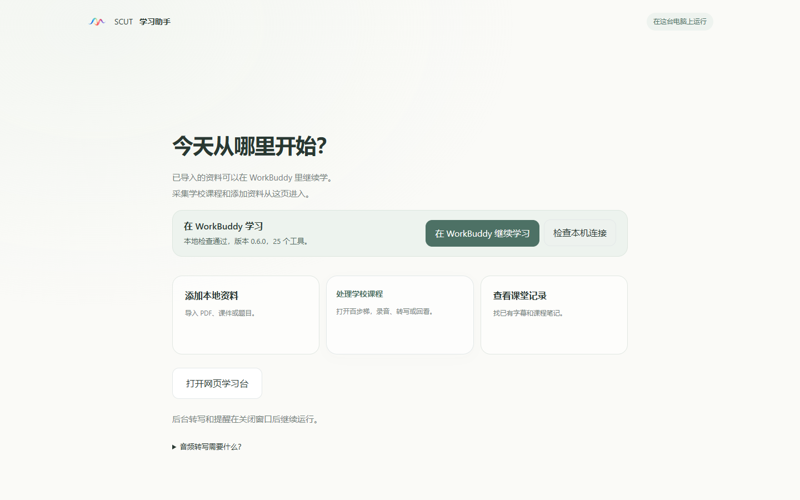

# SCUT 学习助手

把百步梯的课堂记录和电脑里的课件放到一起。上课时记字幕、收提醒，下课后整理笔记；复习时能找到老师的原话，也能按自己的时间安排先学什么。

项目基于 [jbykkk/scut-courses-replay-extraction](https://github.com/jbykkk/scut-courses-replay-extraction) 开发，保留了原有的学校字幕下载功能。

**[在线体验][online]** · **[下载 Windows 安装包][setup]** · [安装与日常使用][start] · [WorkBuddy 接入][workbuddy] · [反馈问题][issues]

主要使用环境：**Windows 10/11 x64 + Edge**，浏览器扩展也支持 Chrome。学校课程需要有权访问百步梯的账号；只读本地资料时不需要登录学校网站。

## 先选版本

| 版本 | 适合谁 | 包含什么 |
| --- | --- | --- |
| [线上演示][online] | 想直接在浏览器体验 | 用原创示例查讲义和课程通知、看课堂记录、做题和查看复习建议。无需登录或 API Key |
| [0.13.0 Windows 预览包][release] | 想先安装使用 | 桌面入口、实时字幕、回放整理、课程笔记、本地资料问答、复习与导出 |
| [开发源码][dev] | 想用新增功能或接入 WorkBuddy | 跨课时问答、今日复习清单、离线思维导图、公开资料核对、五角色专家团与本机连接器 |

**0.13.0 安装包尚不包含开发版的新增功能。** 使用开发版请按下方“从源码运行”安装。

![学习助手主界面][study-image]

截图来自实际程序，使用演示数据，不包含个人课程、账号或密钥。主界面为 0.13.0，下面的跨课时问答和今日清单截图来自开发版。

## 线上版：课程补学助手

打开[线上演示][online]，可以试问“条件变量为什么要在 while 循环里等？”或“松针-27 实验报告现在什么时候交？”。答复附讲义或模拟通知的出处，练习和复习建议可按需展开。课堂记录页可以查看模拟字幕、改期历史、波形和思维导图，也可以导出演示笔记。

网页使用原创样例，支持关键词检索和浏览器端语义检索，无需连接学校系统或安装桌面版。录音、课程同步和导入个人资料请用桌面版。线上版源码及本地预览命令见 [`competition/site/`][online-source]。

## 安装后怎么用

1. 下载 **[SCUT-Study-Setup-0.13.0.exe][setup]**，选择“安装并打开”。安装包自带 Python 和依赖，不需要先安装开发工具。
2. 以后双击桌面或开始菜单里的 **SCUT 学习助手**。本地服务会按需启动，不设置开机自启，也不需要找 CMD 文件。
3. 先添加一份课件，或者输入要处理的课程。不必一次填完课表、考试日期和所有要求。
4. 需要模型解释、生成笔记时，再到设置里保存自己的 API Key。想使用实时字幕，再配置语音模型和 FFmpeg。

安装包目前是未签名的预发布版本。[下载页][release]也提供带运行环境的 ZIP 和 SHA-256 校验文件；ZIP 解压后打开 `SCUT学习助手.exe` 即可。GitHub 自动生成的 `Source code.zip` 是源码包。

### 需要学校课程时

在学习窗口说：**“处理操作系统尚未处理的每一节回放。”**

如果尚未连接学校，任务会等待。点击任务中的“登录百步梯，继续处理”，在学校页面完成登录，再打开对应课程。第一次读取学校课程，需要在 Edge 或 Chrome 中加载项目的 `extension` 文件夹；连接面板会显示目录和步骤。[详细安装步骤][start]

扩展能够读取课程后，任务会继续：有学校字幕就导入，没有字幕就提取音轨、本地转写，再自动生成笔记。已有结果会跳过。保持对应学校页面打开，供扩展读取课时目录和视频地址。

<details>
<summary>查看学校连接与任务等待界面</summary>

![学校连接和登录入口][school-image]

![等待学校连接的课程任务][task-image]

</details>

### 上课时

在课程播放页点击浏览器工具栏里的扩展图标，再点 **开始实时字幕**。这次点击用于授予当前标签页的声音捕获权限，打开页面本身不会自动录音。

可以同时记录多节课，也可以在直播转写时整理回放。课堂实况显示连续字幕和上下文，重要事项会提醒并保存。下课时点 **结束录音并保存**，剩余笔记在后台继续处理。

**关闭控制面板或学习窗口不会结束录音；关闭学校播放页会中断该页的声音采集。** 想回来查看，重新点扩展图标或桌面入口即可。

## 下课后和复习时

**整门课课件自动对应：** 在“课程笔记”页点击“整门课课件”，一次选择多个 PDF/PPTX 或整个课件文件夹，按需调整文件顺序。字幕保存后自动按语义和前后页序对应；新课件会补齐已有课时。支持从字幕跳课件页、从课件页查整门课讲解，无需先生成笔记。配置模型前提供标为待核对的关键词预匹配。[使用说明](manual/COURSEWARE.md)

| 想做的事 | 怎么开始 |
| --- | --- |
| 找作业、测验、评分要求和课程安排 | 打开“课堂记录”，按课程查看重要事项，展开原文和时间段 |
| 对照课件、题目和课堂讲解 | 添加文件、截图或本地路径，再问具体问题 |
| 补上没听懂的内容 | 选定课程和主题，要求从头讲清来龙去脉；想练习时再出题 |
| 定期回顾 | 将主题加入复习，结合之后的作答继续调整 |
| 带走整理结果 | 导出笔记，或要求生成 PDF、Markdown 格式的复习资料与题目 |
| 离开电脑后接收课堂事项 | 在设置中配对手机提醒端，允许通知并开启后台监听 |

在“课程笔记”中打开一节课，选择 **课件与讲述对照 → 选择或上传本课课件**，勾选已有课件或上传 PDF，再点“结合所选课件生成笔记”。可按知识点同时查看课件原文与 PDF 原页、老师原话与回放时间、结合两者整理的笔记。未找到对应课件页时会明确提示；扫描版 PDF 需先做文字识别。导出的 Markdown 同样保留课件页码和老师原话。

开发版可在同一课时选择 **思维导图**，从已有知识点笔记直接生成导图，无需额外调用模型。可展开、折叠、全屏查看，编辑并保存 Markdown 提纲，导出 Markdown、SVG 或 PNG。点击知识点和出处可回到课件与老师原话。笔记更新会保留手动提纲并提示过期。[思维导图使用说明](manual/MINDMAP.md)

资料支持 PDF、PPTX、DOCX、TXT、Markdown 和图片。给出文件夹时会先列出可读文件供选择；原文件只读。图片理解需要支持图片输入的模型。

手机端提供 [Android APK][android]，配对方式见 [手机端说明][mobile]。收到实时提醒需要电脑端继续处理课堂、手机能够访问中继并保持后台监听；电脑正在转写，不代表手机已经连接成功。

### 开发版：带出处的跨课时问答

> 操作系统老师在哪讲过条件变量？给我原句和回看位置。

从已导入的多个课时里找相关讲解，回答附字幕原句、课时、时间段和回看入口。只有相关铺垫、没有直接讲解时，会说明检索到的范围。尚未对齐视频的直播录音保留独立计时，不把录音时间当作视频位置。

<details>
<summary>查看跨课时问答示例</summary>

![跨课时查找课堂原句和回看位置][search-image]

</details>

### 开发版：今日复习清单

> 今晚只有30分钟，先学什么？

结合已确认的作业期限、到期复习和最近作答，给出时间预算内的安排。没有足够记录时先做短诊断，不编造薄弱点、截止日期或考试时间。清单中的一段作业时间只表示推进一部分，不代表整项任务已经完成。

<details>
<summary>查看 30 分钟复习清单</summary>

![按时间预算安排任务和复习][review-image]

</details>

### 开发版：用公开资料核对

> 查公开教材，核对条件变量为什么要在 while 循环里等待。

先找课堂原话，再检索公开教材或论文线索，对照前提、术语和适用范围。当前接入 Crossref、Europe PMC 和部分公开教材入口；论文往往只能取得摘要，回答会说明实际读到的范围。

公开检索只发送概念词。读教材时按问题选取相关段落，保留页码和来源，减少逐页调用。转载同一篇论文不算多个独立来源；检索结果和模型解释不会自动覆盖字幕，也不会自动成为已确认知识。外部资料不能替老师决定考试范围。

## 在 WorkBuddy 里使用（开发版）

WorkBuddy 是复习入口。首次从 SCUT 学习助手首页点 **准备连接器**，再点 **在 WorkBuddy 继续学习**。0.14.0 构建中的 Windows 安装器也可以在安装时准备连接器并做本机进程检查。

在 **专家·技能·连接器 → 连接器 → 自定义连接器** 启用 `scut-study`，首次使用按客户端提示确认信任。新建任务，在输入框用 `/` 选择 SCUT 技能。开发版连接器为 **0.7.0，28 个工具**。以后直接打开 WorkBuddy，学校登录留到导入课程或回看视频时处理。

<details>
<summary>查看 WorkBuddy 接入界面</summary>



</details>

可以直接开始一个学习目标：

> 从头讲神经科学。概念旁给英文，把模型之间的联系讲清楚，每次先讲一部分再问我一道题。

> 接着上次的进度。我还没分清那两个模型，先别给答案。

> 用数字系统设计的课件出一套时序题，题目放前面，解析和出处放最后。

说“接着上次的题”可找回同一道练习，网页学习台也能打开它。作答后查看参考解法和原句。自评可留空，填了会用于今日清单和下次复习。原文更新后可以用新版本出题，旧作答仍可查阅。

WorkBuddy 负责讲解与出题。本地 MCP 取回相关原文、检查引文与位置、保存学习进度。接入时使用 WorkBuddy 账号和本地课程索引即可。[完整接入说明][workbuddy] · [验证记录](workbuddy/VALIDATION.md)

### WorkBuddy 专家团

**SCUT 课程复习组 0.4.0** 包含课程主理人、概念衔接讲师、证据出题员、课程证据复核员和学习规划师。可以用原创讲义试做错因复测，也可以用新旧教师通知核对改期并预览复习安排；连接本机 MCP 后，学生确认才写回任务和计划。

在仓库根目录运行 `python scripts/build_workbuddy_team.py` 生成 `dist/scut-learning-team.zip`。详见[专家团配置与构建][expert-team]、[客户端接入](workbuddy/expert-team/NATIVE_SETUP.md)和[原创演示](workbuddy/demo/README.md)。配置打包与 MCP 流程已有验证；客户端实际成员调度、资料库回写和跨账号分享仍待实测。

## 模型和个人数据

| 功能 | 需要配置什么 |
| --- | --- |
| 查看已保存的课堂记录 | 本地服务，桌面入口会自动启动 |
| 导入学校已有字幕 | 已登录的学校页面与扩展；不需要语音模型 |
| 本地实时转写、缺字幕回放转写 | Whisper 模型文件、FFmpeg，以及 CPU 或兼容 GPU |
| 学习网页的问答、生成笔记与课堂分析 | 自己的模型 API Key，支持 DeepSeek 和其他兼容服务 |
| 图片识读 | 支持图片输入的模型 |
| WorkBuddy 中查询和回答 | 登录 WorkBuddy，并连接本机 MCP；使用 WorkBuddy 自身的模型 |

安装包不含语音模型权重。已有 PotPlayer / Faster-Whisper 环境时，可以在设置中选择现有文件，无需移动。设置会显示 Key 是否已保存，并提供连接检测；输入框留空不会清除已有 Key。

- **安装版数据**：`%LOCALAPPDATA%\SCUTClassroomAssistant\data`，包含笔记、录音缓存、资料索引和运行记录。
- **源码版数据**：项目的 `.local/`；也可通过 `SCUT_ASSISTANT_HOME` 指定目录。
- **API Key**：单独保存在 `%LOCALAPPDATA%\SCUTClassroomAssistant\credentials.json`，使用当前 Windows 账户加密，与代码分开。

使用模型时，相关文字片段或所选图片会发给配置的模型服务；使用 WorkBuddy 时，工具取回的相关片段会交给 WorkBuddy 的模型。学校 Cookie 留在浏览器。手机提醒经过加密中继传送，发布包不含个人设置、课程内容、密钥或模型权重。

识别和分析都可能出错。出处能帮助回查，不能单独证明内容正确；重要日期、课堂要求和有争议的概念仍需核对原文。助手不会替学生签到、答题或提交作业。

## 查看它是怎么工作的

学习网页的 **运行详情** 可以查看系统提示词、工具参数与结果、引用片段、耗时和用量。WorkBuddy 发起的 MCP 调用也会留下本机记录；这里不展示模型内部的思考过程。

<details>
<summary>查看运行详情</summary>

![提示词、工具调用和耗时记录][runtime-image]

</details>

## 从源码运行

最新学习助手功能位于 `main` 分支。需要 Git、[uv](https://docs.astral.sh/uv/) 和 Windows；回归检查另需 Node.js。

```powershell
git clone https://github.com/PoesisQ/bbt_SCUT_admin.git
cd bbt_SCUT_admin
uv sync --extra asr --extra study --python 3.12
# 首次创建桌面与开始菜单入口，以后从图标打开
.\install-desktop.ps1
```

仅调试服务时运行 `uv run --extra asr --extra study python -m assistant_service`，本地页面为 `http://127.0.0.1:8765/study.html`。停止服务前先结束录音和处理任务，再双击项目文件夹中的 `停止课堂助手.cmd`，或运行 `stop-assistant.ps1`。更新源码后重新启动服务，并在浏览器扩展管理页重新加载扩展。

<details>
<summary>检查、打包与原版字幕命令</summary>

```powershell
# Python、JavaScript 回归及格式检查
uv run --extra study python scripts/check.py
# 检查学习稿公式，并用本地排版生成打印PDF
uv run --extra study python scripts/check_study_document.py source.md --render-check --pdf print.pdf
# 浏览器扩展 ZIP
uv run python scripts/package_extension.py
# Windows x64 安装包
uv run --extra study python scripts/build_windows.py
```

Windows 包使用 Python 嵌入式运行环境，依赖见 `requirements-windows.lock`；包内附第三方许可和 `THIRD_PARTY.json`。构建步骤见[发行说明][releasing]。

原命令行字幕下载功能仍可使用：

```powershell
uv run playwright install chromium
uv run main.py login
uv run main.py get "课程链接"
uv run main.py get --all "课程链接"
```

</details>

<details>
<summary>常见问题</summary>

- **本地已连接，但课程读不到**：本地服务、浏览器扩展和学校登录是三个状态。打开任务对应的课程播放页，确认已登录且能够播放。
- **字幕已经有了，笔记分析失败**：检查模型配置后继续生成笔记，不必重新转写整节课。
- **关闭窗口后，怎么回去**：重新打开桌面入口或点扩展图标即可；不要为了打开面板而重新加载正在录音的扩展。
- **手机已配对，但收不到提醒**：配对只表示保存了连接信息。检查后台监听、通知权限和网络；VPN 也可能影响中继连接。
- **WorkBuddy 查不到一门课**：先在学习助手导入资料。已有课堂文字但索引不齐时，连接器会提示，可只刷新这门课的索引；不会重新录音或转写。

反馈问题时请附版本、操作步骤和错误文字，不要提交 API Key、学校 Cookie 或个人数据库。

</details>

[安装与日常使用][start] · [WorkBuddy 接入][workbuddy] · [更新记录][changelog] · [系统设计][design] · [网站接口记录][site] · [验证记录][validation] · [MIT License](LICENSE)

[setup]: https://github.com/PoesisQ/bbt_SCUT_admin/releases/download/v0.13.0/SCUT-Study-Setup-0.13.0.exe
[release]: https://github.com/PoesisQ/bbt_SCUT_admin/releases/tag/v0.13.0
[android]: https://github.com/PoesisQ/bbt_SCUT_admin/releases/download/v0.10.7/SCUT-Classroom-Alerts-v0.10.7.apk
[issues]: https://github.com/PoesisQ/bbt_SCUT_admin/issues
[dev]: https://github.com/PoesisQ/bbt_SCUT_admin/tree/main
[online]: https://scut-buxue-2026.app.workbuddy.host/?sharecode=YRGCACKBQL
[online-source]: competition/site/README.md
[expert-team]: workbuddy/expert-team/README.md
[start]: manual/START.md
[workbuddy]: workbuddy/README.md
[mobile]: https://github.com/PoesisQ/bbt_SCUT_admin/blob/main/mobile/README.md
[changelog]: https://github.com/PoesisQ/bbt_SCUT_admin/blob/main/CHANGELOG.md
[design]: https://github.com/PoesisQ/bbt_SCUT_admin/blob/main/planning/STUDY_TECHNICAL.md
[site]: https://github.com/PoesisQ/bbt_SCUT_admin/blob/main/SITE_FINDINGS.md
[validation]: https://github.com/PoesisQ/bbt_SCUT_admin/blob/main/VALIDATION.md
[releasing]: https://github.com/PoesisQ/bbt_SCUT_admin/blob/main/manual/RELEASING.md
[study-image]: https://raw.githubusercontent.com/PoesisQ/bbt_SCUT_admin/59ac3f008901249b98858e4ce0f3bd99373101cc/manual/images/02-study.png
[school-image]: https://raw.githubusercontent.com/PoesisQ/bbt_SCUT_admin/59ac3f008901249b98858e4ce0f3bd99373101cc/manual/images/03-school.png
[task-image]: https://raw.githubusercontent.com/PoesisQ/bbt_SCUT_admin/59ac3f008901249b98858e4ce0f3bd99373101cc/manual/images/05-task.png
[search-image]: https://raw.githubusercontent.com/PoesisQ/bbt_SCUT_admin/59ac3f008901249b98858e4ce0f3bd99373101cc/manual/images/05-classroom-search.png
[review-image]: https://raw.githubusercontent.com/PoesisQ/bbt_SCUT_admin/59ac3f008901249b98858e4ce0f3bd99373101cc/manual/images/06-today-review.png
[runtime-image]: https://raw.githubusercontent.com/PoesisQ/bbt_SCUT_admin/59ac3f008901249b98858e4ce0f3bd99373101cc/manual/images/04-runtime.png
