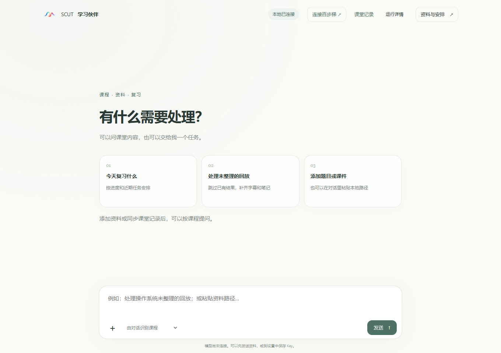
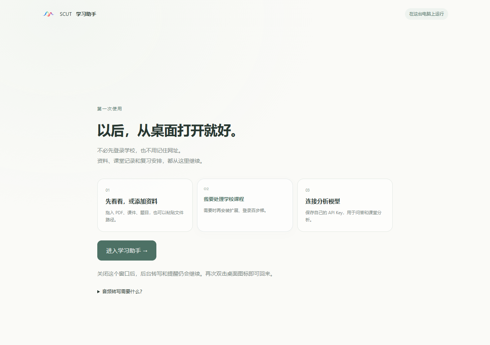
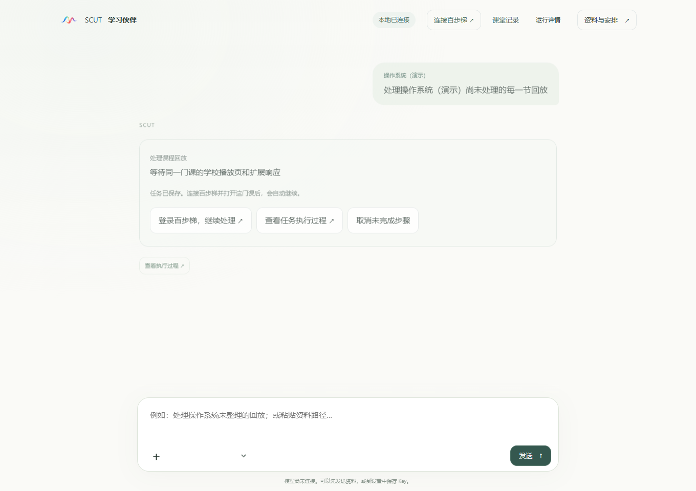
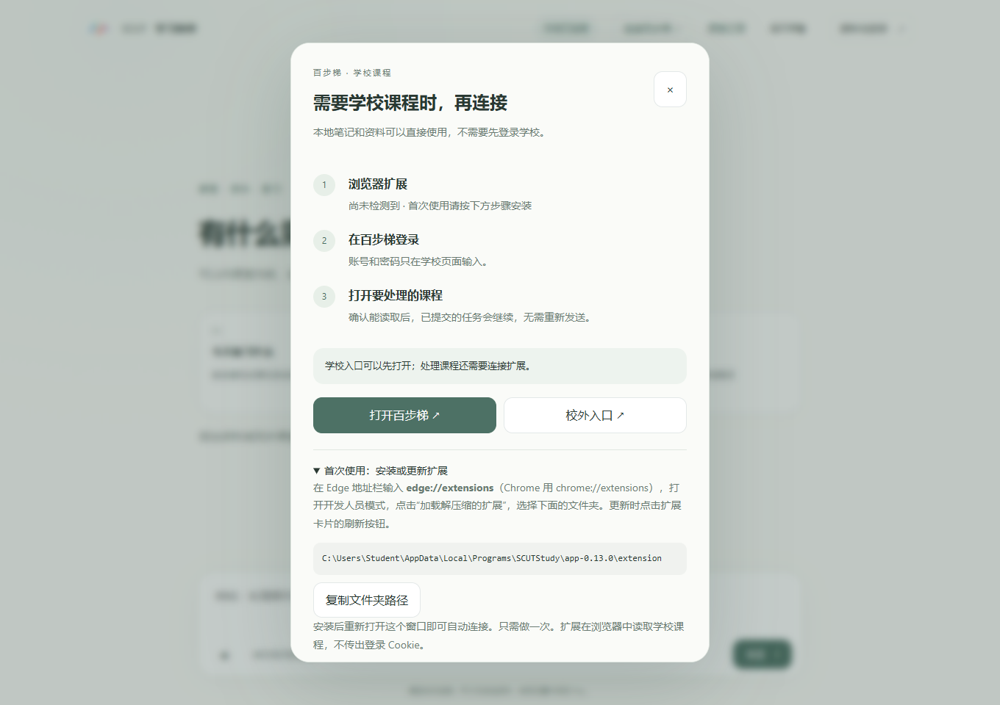
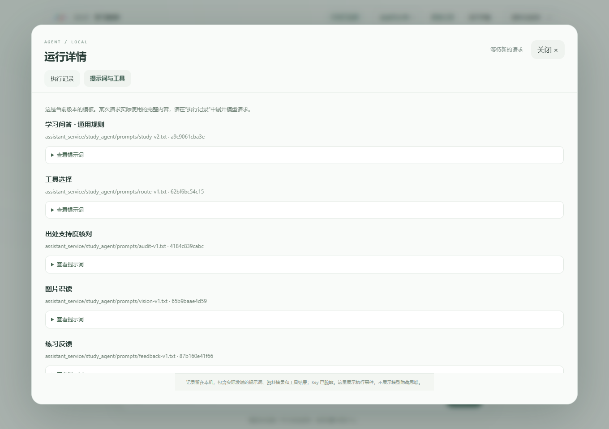

# SCUT 学习助手

把百步梯里的课堂记录和电脑里的课件放到一起：整理回放、找老师提到的要求、对照题目复习。平时从桌面打开，需要学校课程时再登录百步梯。

项目基于 [jbykkk/scut-courses-replay-extraction](https://github.com/jbykkk/scut-courses-replay-extraction) 开发，保留了原有的学校字幕下载功能。

**[下载 Windows 安装包](https://github.com/PoesisQ/bbt_SCUT_admin/releases/tag/v0.13.0)** · [安装与使用](manual/START.md) · [更新记录](CHANGELOG.md) · [反馈问题](https://github.com/PoesisQ/bbt_SCUT_admin/issues)



以上及下方均为 v0.13.0 实际程序截图，使用隔离的演示环境，不包含真实课程、账号或 API Key。

## 安装一次，以后直接打开

1. 在 Releases 下载 **SCUT-Study-Setup-0.13.0.exe**，选择“安装并打开”。支持 Windows 10/11 x64，自带 Python 和运行库，无需安装开发工具。
2. 以后双击桌面或开始菜单里的 **SCUT 学习助手**。它会按需启动本地服务，然后打开学习窗口，不设开机自启。
3. 先添加一份资料，或者告诉它要处理哪门课。不必一开始填写课表和所有课程信息。

安装包目前是预发布版本，尚未签名。`Source code.zip` 是开发源码；普通使用请选择上面的 EXE。也提供带运行环境的 ZIP，解压到固定位置后打开 `SCUT学习助手.exe`；需要桌面入口时运行一次 `install-desktop.ps1`。



## 需要百步梯时再登录

可以直接说：**“处理操作系统尚未处理的每一节回放。”**

任务先保存在本机。如果没有打开对应学校页面，点击任务里的“登录百步梯，继续处理”。助手会打开已记录的课程链接；第一次接触的课程需要在百步梯里选一次。校外可以改用校外入口。

账号、密码和验证码在学校页面输入。扩展确认能够读取同一门课后，会接着读取目录、跳过已有结果，再提交缺少的课时。刷新或关闭学习窗口不会丢掉这个任务。



首次读取学校课程需要安装浏览器扩展。连接面板会给出扩展目录和步骤，Edge / Chrome 均可使用。扩展暂未上架商店，因此“加载解压缩的扩展”这一步需要自己完成一次；[Microsoft 的安装说明](https://learn.microsoft.com/en-us/microsoft-edge/extensions-chromium/getting-started/extension-sideloading)。更新扩展后需在扩展管理页刷新一次。



## 平时能做什么

| 想做的事 | 从哪里开始 |
| --- | --- |
| 整理一门课的回放 | 输入课程名称和任务；有学校字幕时优先导入，没有时本地转写 |
| 上课时记录和提醒 | 在学校播放页点击扩展，开始实时字幕；支持多课堂同时捕获 |
| 找作业、测验和课程安排 | 打开“课堂记录”，按课程查看重要事项和原文时间段 |
| 对照题目、课件和课堂讲解 | 拖入文件、粘贴截图或本地路径，再提出具体问题 |
| 复习与出题 | 指定主题和可用时间，结合资料练习；可安排周期复习 |
| 导出复习资料 | 说“把本课复习要点和题目导出为 PDF 和 Markdown” |
| 在手机接收课堂事项 | 在设置里配对手机提醒端；电脑、学校页面和手机后台监听需保持运行 |
| 看它用了哪些资料和工具 | 打开“运行详情”，查看提示词、工具参数、结果、耗时和 token 用量 |



资料支持 PDF、PPTX、DOCX、TXT、Markdown 和图片。文件夹会先列出可读取文件，供你选择。原文件只读；课堂原文、模型解释和确认过的知识分开保存，资料更新后会重新核对引用。

## 哪些功能需要额外配置

| 功能 | 需要 |
| --- | --- |
| 查看已有笔记、添加本地资料 | 本地服务；桌面入口会自动启动 |
| 下载学校已有字幕 | 已登录的百步梯页面和扩展 |
| 问答、生成笔记与课堂分析 | 自己的模型 API Key；默认支持 DeepSeek，也可配置其他兼容服务 |
| 直播或缺字幕回放的本地转写 | Whisper 模型文件和 FFmpeg；运行库已包含，模型权重不随包下载 |
| 图片内容识读 | 支持图片输入的模型配置；纯文本模型不能读取图片 |

有现成 PotPlayer / Faster-Whisper 环境时可在设置中选择现有文件，无需移动它们。没有 NVIDIA GPU 时可选 CPU。设置显示 Key 是否已保存，也能单独检测远程连接；输入框留空不会清除已有 Key。

识别和分析可能出错。重要日期、要求和概念请通过原文、时间戳和课件核对；不会替学生签到、答题或交作业。关闭学习窗口后，服务和后台任务仍在运行；关闭学校播放页会结束该页的实时音频捕获。

## 数据放在哪里

安装版的笔记、录音缓存、资料索引与运行记录位于 `%LOCALAPPDATA%\SCUTClassroomAssistant\data`。API Key 使用当前 Windows 账户加密，单独保存在 `%LOCALAPPDATA%\SCUTClassroomAssistant\credentials.json`。更新程序不会覆盖这两个位置。

源码运行仍默认使用项目 `.local/`，也可通过 `SCUT_ASSISTANT_HOME` 指定目录。开启模型分析时，相关文字摘录、所选图片会发送给你配置的模型服务。学校登录 Cookie 留在浏览器里。发布包不含个人设置、课堂数据、Key 或模型文件。

## 开发与构建

```powershell
uv sync --extra asr --extra study
uv run --extra asr --extra study python -m assistant_service
# 源码运行首次创建桌面入口
.\install-desktop.ps1
# 回归检查，另需 Node.js 和 Git
uv run --extra study python scripts/check.py
# 扩展 ZIP
uv run python scripts/package_extension.py
# Windows x64 安装包（Windows + Python 3.12 + uv）
uv run --extra study python scripts/build_windows.py
```

Windows 包使用 Python 官方嵌入式发行版，将依赖随应用分发；[Python 官方说明](https://docs.python.org/3.12/using/windows.html#the-embeddable-package)。构建清单和依赖版本见 `requirements-windows.lock`。包内保留第三方许可证及 `THIRD_PARTY.json`，下载页提供 SHA-256 校验文件。

原命令行字幕工具仍可使用：`uv run main.py login`、`uv run main.py get "课程链接"`，批量加 `--all`；首次运行需 `uv run playwright install chromium`。

[详细功能](ASSISTANT.md) · [网站接口记录](SITE_FINDINGS.md) · [学习系统设计](planning/STUDY_TECHNICAL.md) · [验证记录](VALIDATION.md) · [发行说明](manual/RELEASING.md) · [MIT License](LICENSE)
