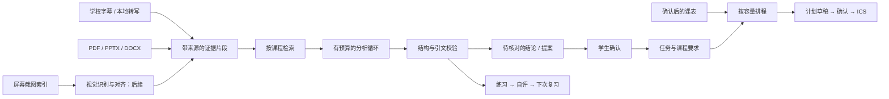

# 学习工作台：实现说明

## 数据流



## 模块

`assistant_service/study_agent/` 不接管音频线程。通过现有 FastAPI 的 `/api/study/` 接入，沿用本地请求的 Host、Origin 和连接口令检查。网页入口为 `study.html`。

- `storage.py`：独立 SQLite 库 `study-agent.sqlite3`。源内容按指纹去重，原位置更新时使旧版本退出新检索，历史引文保留。
- `ingest.py`：只读注册资料目录；跳过虚拟环境、代码依赖、隐藏配置与疑似凭证文件。保留页码、幻灯片号或字幕时间。提取不到文字返回失败，不能把扫描版 PDF 标记为成功。
- `timetable.py`：按学校导出 PDF 的九列表格读取，保留周次。只是候选课表，必须确认学期与节次时间后才能展开。
- `reasoner.py`：自定义 HTTP 模型适配；自动工具包括限定当前课程的检索与相邻段落展开。每轮最多 3 次模型调用，每次最多 3500 输出 token；图片输入先用一次视觉读取，随后最多两次核对调用。文本调用 30 秒超时、图片读取 35 秒超时。来源最多 12 段，超过上下文预算不再追加。JSON 与逐字引文校验失败时限次修复，不能通过则不保存新提案。
- `planner.py`：按确认的耗时上限、截止日期、难度和空闲时段安排，不用模型生成时间表。没有截止日期就没有到期事实。
- `api.py`：资料、提案、计划、练习和课表的状态接口。学习模型调用限为同时 1 个，避免新功能抢占课堂即时事项分析的请求。
- `extension/visual-evidence.js`：只读当前课时 DOM 的 `.ppt_wrap` / `.ppt_time` / `img[data-src]`；校验学校域名、课时和 PPT 图片路径；不导出学校 Cookie。

## 四种记忆不要混用

| 记录 | 谁能写 | 如何使用 |
| --- | --- | --- |
| 原始证据 | 资料导入、课堂同步 | 可引用，不由模型覆盖 |
| 课程要求 | 学生确认后的提案 | 可作为后续问答的上下文 |
| 学习情况 | 学生的完成记录和练习自评 | 用于调整建议，明确属于自报 |
| 模型提案 | 经校验的分析输出 | 等待确认，不自动变成事实或通知 |

目前的引文校验保证“引用确实来自读到的原文”，不能保证模型解释一定正确。语义支持关系、否定、版本先后和跨来源纠错还须通过人工评测改进。纠错提案至少引用两个不同来源；原字幕不被改写。

## 模型配置

不配置新文件时，直接复用已有 DeepSeek Key 和所选模型。网页会显示模型配置是否存在；这不等同于已验证服务连通。

其他兼容服务可在本地 `.local/study-providers.json` 设置。该文件不进仓库，密钥存环境变量，示例见 `config-examples/study-providers.example.json`。本机推理服务可用 HTTP，远程服务要求 HTTPS。默认不跟随重定向；只有精确的 DeepSeek 官方域名可以复用原 Key。

版本化提示词在 `prompts/study-v1.txt`。工具返回的是非可信来源数据，不能授权读文件、调用外部接口或改变工具集合。执行日志保存调用步骤和引用，不记录密钥和模型内部推理。

## 安装与运行

```powershell
uv sync --extra asr --extra study
```

沿用现有启动方式，打开 `http://127.0.0.1:8765/study.html`，或者从扩展的“课程笔记”导航进入“学习工作台”。从浏览器扩展打开时可以读取学校页的 PPT 索引；普通本地网页没有浏览器标签页权限。

直接输入问题、拖入课件或粘贴截图即可开始。课程不明确时只追问课程名；连续追问会携带同门课的最近上下文。任务、资料和课表放在“资料与安排”中按需打开。扫描 PDF 仍需先提取关键页面为图片；复杂公式和手写图像必须回查原图。

## 平台接入边界

WorkBuddy 官方支持 MCP 连接器与 CLI 连接器，本地 MCP 可使用 stdio。本轮提供 `python -m assistant_service.study_agent.mcp --data-dir <本地数据目录>`，暴露课程列表、课程检索、原文回查和已确认任务四个只读工具。配置示例在 `config-examples/workbuddy-mcp.example.json`。连接后，平台可读取工具返回的课程片段，因此只应连接学生选择使用的平台工作空间。确认任务、日历写入和通知发送仍留在工作台。参赛发布需另行完成真实的平台部署与访问验证。

参考：[WorkBuddy 连接器规范](https://open.workbuddy.cn/docs/connector)、[MCP stdio 规范](https://modelcontextprotocol.io/specification/2025-11-25/basic/transports)。本轮完成本地协议测试，尚未在 WorkBuddy 账号中联调，也未提交或安装市场连接器。

图片通过 Chat Completions 的 image_url 内容块发送。DeepSeek Flash 默认启用视觉能力；其他模型需显式配置 supports_images。图片先识读为带原图链接、标明未核对的证据，再与课件和课堂上下文核对。不得把视觉识读结果标成已校验的原文。参考：[DeepSeek Vision](https://api-docs.deepseek.com/guides/vision/)。

## 连续对话与复习事件

- `dialogue.py` 保存消息、附件引用与运行状态；同一请求 ID 不重复调用模型。按课程隔离最近六轮上下文，换课时不混入上一门课的回答。
- `attachments.py` 接收学生选中的文档和图片，不要求先填写文件夹路径。附件只存在 `.local/study-uploads`，发送消息时才将相关文字或所选图片交给模型。单文件 12 MB，每轮最多四份，总计 24 MB。
- `reviews.py` 保存复习主题、到期时间、反馈和周期。手机发送沿用原有加密 outbox；重启后继续，暂停/推迟会使旧通知失效。22:00—08:00 不发送复习通知，每天最多两条；不会阻塞点名等课堂提醒。电脑休眠或本地服务停止时不能发送。
- 普通回答先展示两个关键点，其余内容可展开。知识串联必须有两处不同证据；深入总结围绕核心问题、推导关系和适用边界。
- 要求录入采用一问一步：先确认事项，再核对截止，最后估计用时；不知道的日期可留空，不好估计的大任务可以继续拆分。

当前没有接入微信或 QQ。对话接口与渠道无关，后续可以复用相同消息、提案和复习状态，避免每个渠道各自保存一份进度。当前跨课程的自动知识图谱、客观作答评分、学习计划自动重排仍未实现。
