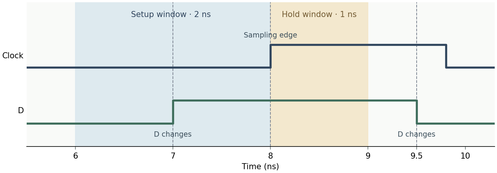

# 数字电路 · 松针-27 时序补学

这是原创教学算例。以下时间均在触发器 D 输入和时钟引脚处读出，单位为 ns。

## 第 9 页 · 读时序波形

松针-27 原例的采样沿在 8 ns，D 在 7 ns 变为稳定，在 9.5 ns 再次变化。建立时间（setup time）要求沿前稳定 2 ns，保持时间（hold time）要求沿后稳定 1 ns。先在时钟上标出 8 ns，再在数据线上找到采样沿左右最近的两次变化。

## 第 10 页 · 原例计算

沿前实际稳定 `8 − 7 = 1 ns`，比建立时间要求少 `2 − 1 = 1 ns`。沿后实际稳定 `9.5 − 8 = 1.5 ns`，满足 `1 ns` 的保持时间要求。两项要分别检查。

## 第 11 页 · 变式一

把 D 变为稳定的时刻从 7 ns 改为 6 ns，采样沿仍在 8 ns，D 下次变化仍在 9.5 ns。沿前稳定 `8 − 6 = 2 ns`，恰好满足建立时间要求；沿后稳定 `1.5 ns`，仍满足保持时间要求。

## 第 12 页 · 变式二

若 D 在 5.5 ns 稳定，在 8.5 ns 再次变化，采样沿仍在 8 ns。沿前稳定 `2.5 ns`，满足 2 ns 的建立时间要求；沿后只稳定 `0.5 ns`，比 1 ns 的保持时间要求少 `0.5 ns`。

[AMD 时序检查说明](https://docs.amd.com/r/2024.1-English/ug949-vivado-design-methodology/Understanding-Timing-Reports)
